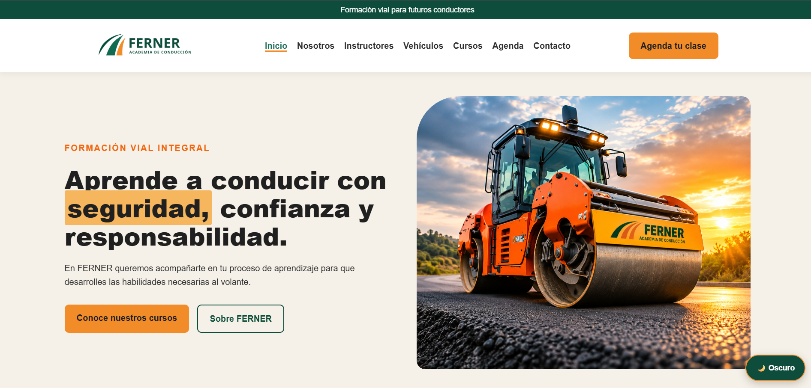
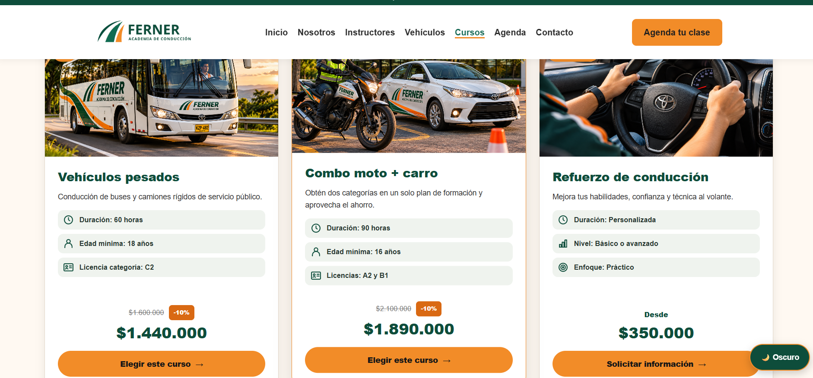
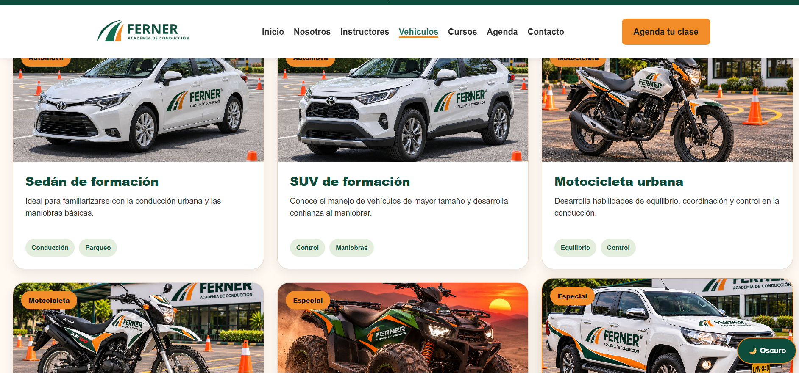
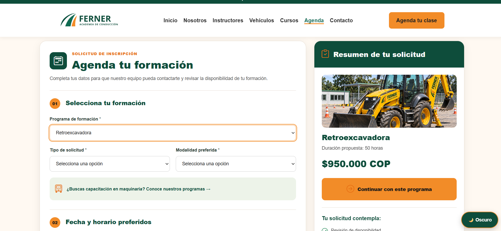

# 🚗 FERNER | Academia de Conducción

### Formación vial para futuros conductores

**Proyecto académico de desarrollo web | HTML5 + CSS3 | 2026**

FERNER es un sitio web multipágina que presenta una **academia de conducción ficticia** enfocada en la formación vial y en capacitaciones de operación de maquinaria. Su objetivo es ofrecer una experiencia clara, atractiva y adaptable a diferentes dispositivos para que una persona pueda conocer los programas, explorar la flota, comparar precios e iniciar una solicitud de inscripción.

> **Aviso importante:** FERNER es un proyecto académico y de demostración. Los precios, descuentos, duraciones, instalaciones, vehículos, instructores y testimonios mostrados son ilustrativos; no representan una oferta comercial vigente ni acreditan una academia real. Los formularios no envían información ni reciben pagos.

---

## 📸 Vista previa

Estas capturas se mostrarán cuando agregues las imágenes a la carpeta `docs/capturas/` con los nombres indicados.

| Inicio | Cursos y precios |
|:---:|:---:|
|  |  |

| Vehículos y maquinaria | Agenda de formación |
|:---:|:---:|
|  |  |


---

## 📑 Tabla de contenido

1. [Descripción del proyecto](#-descripción-del-proyecto)
2. [Objetivos](#-objetivos)
3. [Tecnologías utilizadas](#-tecnologías-utilizadas)
4. [Estructura del proyecto](#-estructura-del-proyecto)
5. [Páginas del sitio](#-páginas-del-sitio)
6. [Funcionalidades implementadas](#-funcionalidades-implementadas)
7. [Catálogo de cursos y precios](#-catálogo-de-cursos-y-precios)
8. [Capacitaciones en maquinaria](#-capacitaciones-en-maquinaria)
9. [Diseño visual y experiencia de usuario](#-diseño-visual-y-experiencia-de-usuario)
10. [Diseño responsive](#-diseño-responsive)
11. [Accesibilidad](#-accesibilidad)
12. [Cómo ejecutar el proyecto](#-cómo-ejecutar-el-proyecto)
13. [Proceso de desarrollo](#-proceso-de-desarrollo)
14. [Retos y soluciones](#-retos-y-soluciones)
15. [Alcance y limitaciones](#-alcance-y-limitaciones)
16. [Posibles mejoras](#-posibles-mejoras)
17. [Autor y créditos](#-autor-y-créditos)

---

## 🎯 Descripción del proyecto

**FERNER Academia de Conducción** nace como una propuesta de interfaz web institucional para representar los servicios de una academia moderna. El sitio permite consultar información relevante sin depender de una aplicación compleja: sus páginas están conectadas mediante enlaces, sus galerías presentan los vehículos de formación y su página de cursos reúne precios y características de cada programa.

El desarrollo se realizó **sin JavaScript, sin frameworks de interfaz y sin base de datos**. Los comportamientos visuales e interacciones permitidas se construyeron con HTML y CSS, aprovechando herramientas como `Grid`, `Flexbox`, `@media`, `@keyframes`, `:hover`, `:focus-visible`, `:checked`, `:has()`, `<details>` y `<summary>`.

### Público al que está dirigido

- Personas interesadas en aprender a conducir automóvil o motocicleta.
- Aspirantes a formación para vehículos de servicio público y vehículos pesados.
- Conductores que desean mejorar su confianza mediante clases de refuerzo.
- Personas interesadas en conocer capacitaciones de maquinaria agrícola, industrial y de construcción.

## ✅ Objetivos

### Objetivo general

Diseñar y maquetar un sitio web institucional, visualmente coherente, adaptable y fácil de navegar que presente los servicios de FERNER mediante **HTML5 y CSS3**.

### Objetivos específicos

- Construir varias páginas con una identidad de marca unificada.
- Organizar el contenido con etiquetas semánticas de HTML.
- Presentar programas de formación mediante tarjetas y una tabla comparativa.
- Mostrar vehículos y maquinaria en galerías visuales.
- Implementar filtros de categorías usando únicamente HTML y CSS.
- Incorporar un formulario demostrativo de solicitud de inscripción.
- Diseñar navegación adaptada a computadores, tablets y celulares.
- Ofrecer un cambio entre modo claro y modo oscuro sin JavaScript.
- Aplicar efectos `hover`, transiciones y animaciones con CSS.
- Documentar la estructura, el proceso, las decisiones y los límites del proyecto.

## 🛠 Tecnologías utilizadas

| Tecnología o herramienta | Utilidad en FERNER |
|---|---|
| **HTML5** | Estructura de páginas, encabezados, navegación, secciones, tablas, formularios y contenido semántico. |
| **CSS3** | Estilos, colores, tipografía, distribución, responsive, filtros, animaciones y modo oscuro. |
| **CSS Grid** | Distribución de tarjetas, columnas y galerías. |
| **Flexbox** | Alineación de menús, botones, información y componentes. |
| **Media queries** | Ajustes de diseño según el ancho de la pantalla. |
| **Pseudoclases CSS** | Interacción con `:hover`, `:checked`, `:has()`, `:target` y `:focus-visible`. |
| **Bootstrap Icons** | Iconos visuales integrados mediante hoja de estilos CDN. |
| **SVG** | Logotipo y ciertos iconos escalables. |
| **Visual Studio Code** | Edición y organización del código fuente. |
| **Live Server** | Visualización local durante el desarrollo. |
| **Git y GitHub** | Control de versiones y publicación del repositorio de código. |

**Restricción principal del proyecto:** no utilizar JavaScript para las funcionalidades implementadas.

## 📁 Estructura del proyecto

Esta es la organización principal utilizada en el desarrollo; algunos módulos auxiliares de CSS pueden variar según la versión del proyecto.

```text
FERNER/
├── index.html                 # Página de inicio
├── sobre.html                 # Nuestra historia, principios y testimonios
├── instructores.html          # Equipo de instructores
├── vehiculos.html            # Flota vehicular y maquinaria
├── cursos.html               # Cursos, precios y tabla comparativa
├── agenda.html               # Formulario demostrativo de inscripción
├── contacto.html             # Información y consultas de contacto
│
├── css/
│   ├── styles.css            # Entrada a los estilos generales
│   ├── reset.css             # Normalización de estilos
│   ├── variables.css         # Colores, tipografía y variables
│   ├── layout.css            # Estructura general e inicio
│   ├── componentes.css       # Componentes reutilizables
│   ├── animaciones.css       # Animaciones generales
│   ├── responsive.css        # Ajustes responsive generales
│   ├── nosotros.css          # Estilos de Nosotros
│   ├── instructores.css      # Estilos de Instructores
│   ├── vehiculos.css         # Estilos de Vehículos
│   ├── cursos.css            # Estilos de Cursos
│   ├── agenda.css            # Estilos de Agenda
│   └── contacto.css          # Estilos de Contacto
│
├── assets/
│   ├── img/                  # Fotos e imágenes ilustrativas
│   └── icons/                # Logotipo e iconos SVG/PNG
│
├── docs/
│   └── capturas/             # Capturas para este README
│
└── README.md                 # Documentación del proyecto
```

### Organización del CSS

La estructura separa los **estilos compartidos** de los **estilos específicos** de cada página. Por ejemplo, `css/styles.css` se carga de forma general y `css/cursos.css` solamente se agrega en `cursos.html`. Esto facilita ubicar reglas, corregir diseños y evitar que un cambio afecte páginas no relacionadas.

## 🧭 Páginas del sitio

### 1. Inicio — `index.html`

Es la entrada principal al proyecto. Presenta el logotipo, la navegación, un hero con mensaje institucional y un carrusel fotográfico desarrollado con animaciones CSS. Incluye una franja de beneficios, cuatro tarjetas de programas —automóvil, motocicleta, maquinaria y refuerzo—, argumentos para elegir FERNER y un llamado a la acción para agendar.

**Aspectos destacados:** carrusel automático de fotografías, tarjetas con imágenes de fondo, degradados, efecto de elevación `hover`, enlaces hacia las páginas de cursos y navegación responsive.

### 2. Nosotros — `sobre.html`

Explica la propuesta institucional mediante una presentación inicial, una sección de historia, misión, visión, propósito y filosofía, además de los valores de seguridad, responsabilidad, respeto y compromiso.

Se añadió una sección ampliada de **compromiso con el aprendizaje y la seguridad**, acompañada por una imagen representativa de la relación entre instructor y estudiante. El contenido también incluye testimonios **ficticios, utilizados únicamente como ejemplos** en una cinta horizontal animada.

**Aspectos destacados:** alternancia de imagen y texto, tarjetas institucionales, iconografía SVG y Bootstrap Icons, y animaciones visuales.

### 3. Instructores — `instructores.html`

Presenta dos grupos: instructores de conducción y personal ilustrativo de formación en maquinaria. Utiliza tarjetas individuales con fotografías, nombres y descripciones de especialidad.

**Aspectos destacados:** presentación visual del equipo, cuadrículas responsive y animaciones de imagen. Los perfiles son ilustrativos para la maqueta académica.

### 4. Vehículos — `vehiculos.html`

Ofrece un catálogo dividido en dos bloques:

- **Flota de conducción:** automóvil sedán, SUV, motocicleta urbana, motocicleta mixta, cuatrimoto, camioneta, van, bus y camión.
- **Maquinaria especializada:** tractor, excavadora, retroexcavadora, montacargas, cosechadora, minicargador, bulldozer, motoniveladora y rodillo compactador.

La flota de conducción cuenta con filtros de **Todos, Automóviles, Motocicletas y Especiales**, implementados mediante controles `radio` y selectores CSS `:has()`. Cada tarjeta incluye fotografía, categoría, descripción y características.

**Aspectos destacados:** filtros sin JavaScript, tarjetas con efecto hover y galería responsive. Las imágenes no constituyen evidencia de una flota real.

### 5. Cursos y precios — `cursos.html`

Es una de las páginas centrales del proyecto. Contiene una portada propia, filtros de programas, seis tarjetas de cursos de conducción, una **tabla comparativa de precios y duración**, nueve tarjetas de capacitación en maquinaria y una sección de preguntas frecuentes desplegables.

Cada tarjeta reúne una descripción, duración propuesta, categoría o modalidad, precio ilustrativo y enlace de consulta o inscripción. Las preguntas frecuentes abordan licencias, requisitos, duración, costos adicionales y medios de pago.

**Aspectos destacados:** filtros CSS, tarjetas con precios y descuentos, comparación tabular, enlaces directos a Agenda y acordeones nativos `<details>`.

### 6. Agenda — `agenda.html`

Representa el proceso de solicitud de inscripción. Incluye un formulario dividido en pasos:

1. Selección del curso o capacitación.
2. Fecha y horario de preferencia.
3. Datos de contacto y observaciones.
4. Aceptación de la política de privacidad.

El selector contempla los seis cursos de conducción y nueve capacitaciones de maquinaria. A su lado hay un panel de **resumen del programa**, con imagen, duración y precio. Parte de este comportamiento se logra con `:has()` y el valor seleccionado del `<select>`.

Los enlaces de cursos pueden incluir fragmentos de URL, por ejemplo `agenda.html#curso-a2`, para llevar al visitante hacia el programa de su interés. La selección o confirmación final requiere interacción del usuario.

**Importante:** el botón de envío está deshabilitado porque no existe un servicio receptor configurado. El formulario es una demostración visual y **no registra solicitudes reales**.

### 7. Contacto — `contacto.html`

Reúne los puntos de contacto y consultas del sitio, y sirve como destino de los enlaces utilizados en las capacitaciones. Los datos exhibidos son de demostración. Cualquier recepción real de mensajes requeriría conectar un servicio o backend.

## ⚙️ Funcionalidades implementadas

| Funcionalidad | Implementación | Resultado |
|---|---|---|
| Navegación principal | Enlaces `<a>` | Conecta las distintas páginas. |
| Menú móvil | `<details>` y `<summary>` | Permite expandir u ocultar las opciones sin JavaScript. |
| Modo oscuro | Checkbox `#modo-oscuro` + `body:has(#modo-oscuro:checked)` | Cambia la apariencia de elementos preparados para ambos temas. |
| Filtros de flota | Radio buttons + `:checked` + `:has()` | Oculta tarjetas que no corresponden a la categoría. |
| Filtros de cursos | Radio buttons + `:has()` | Muestra los programas de la categoría seleccionada. |
| Preguntas frecuentes | `<details>` y `<summary>` | Abre y cierra respuestas. |
| Tabla comparativa | `<table>`, `<thead>`, `<tbody>`, `<th>` y `<td>` | Permite comparar cursos mediante datos organizados. |
| Galerías responsive | CSS Grid y media queries | Reorganiza las tarjetas según el dispositivo. |
| Animaciones | `@keyframes`, `animation` y `transition` | Añade movimiento a imágenes, títulos, tarjetas y botones. |
| Resumen de Agenda | CSS `:has()` y opciones seleccionadas | Muestra una tarjeta informativa según el programa. |
| Navegación a cursos concretos | Fragmentos `#curso-a2`, `#curso-b1`, etc. | Lleva al formulario desde las tarjetas. |
| Interacción de teclado | `:focus-visible` | Resalta los elementos enfocados. |

### Ejemplo: modo oscuro sin JavaScript

```html
<input type="checkbox" id="modo-oscuro" class="tema-checkbox">
<label for="modo-oscuro" class="tema-boton">🌙 Oscuro</label>
```

```css
body:has(#modo-oscuro:checked) .footer-principal {
    background-color: #192F25;
}
```

El estado del tema **no se guarda entre páginas o recargas**, porque el proyecto no emplea almacenamiento ni JavaScript.

### Ejemplo: filtro de tarjetas con CSS

```css
.flota-contenedor:has(#filtro-motos:checked)
.flota-tarjeta:not([data-categoria="motocicletas"]) {
    display: none;
}
```

Esto permite ocultar los vehículos que no pertenecen a la categoría seleccionada sin programar eventos con JavaScript.

## 💰 Catálogo de cursos y precios

Los siguientes datos corresponden al contenido **ilustrativo** de `cursos.html`, no a tarifas oficiales.

| Programa | Categoría | Duración propuesta | Precio ilustrativo |
|---|:---:|:---:|---:|
| Motocicleta | A2 | 40 horas | $945.000 COP |
| Automóvil particular | B1 | 50 horas | $1.035.000 COP |
| Servicio público liviano | C1 | 60 horas | $1.215.000 COP |
| Vehículos pesados | C2 | 60 horas | $1.440.000 COP |
| Combo moto + carro | A2 + B1 | 90 horas | $1.890.000 COP |
| Refuerzo de conducción | Práctica | Personalizada | Desde $350.000 COP |

Se representaron descuentos del 10 % en algunas tarjetas. Son parte del ejercicio visual y no una promoción comercial.

### Tabla comparativa

La página dispone de una sección específica para comparar nombre, categoría, duración y precio de los seis programas, junto con enlaces de inscripción. Se utiliza una **tabla semántica**, no una imagen, para que la información sea seleccionable y legible.

## 🚜 Capacitaciones en maquinaria

| Equipo | Área | Duración propuesta | Precio ilustrativo |
|---|---|---|---:|
| Tractor agrícola | Agrícola | 40 horas | $890.000 COP |
| Excavadora hidráulica | Construcción | 60 horas | $1.250.000 COP |
| Retroexcavadora | Construcción | 50 horas | $950.000 COP |
| Montacargas | Industrial | 40 horas | $600.000 COP |
| Cosechadora agrícola | Agrícola | Por definir | Cotizar |
| Minicargador | Construcción | 40 horas | $850.000 COP |
| Bulldozer | Movimiento de tierras | Por definir | Cotizar |
| Motoniveladora | Nivelación | Por definir | Cotizar |
| Rodillo compactador | Compactación | Por definir | Cotizar |

Este bloque tiene su propia galería en `vehiculos.html` y un catálogo de programas en `cursos.html#maquinaria`. Las capacitaciones no deben confundirse con la expedición automática de una licencia de conducción ni con certificaciones oficiales.

## 🎨 Diseño visual y experiencia de usuario

### Identidad gráfica

La marca FERNER utiliza una combinación de tonos relacionados con confianza, movilidad y energía:

| Elemento | Color de referencia | Código |
|---|---|---|
| Verde institucional | Verde profundo | `#0E4D3B` |
| Naranja de énfasis | Naranja cálido | `#F28C28` |
| Crema de fondo | Crema claro | `#F5F1E8` |
| Fondo alternativo | Marfil | `#FFF9F2` |
| Texto principal | Gris casi negro | `#202020` |

Se usan esquinas redondeadas, sombras suaves, tarjetas, iconos, fotografías amplias y degradados para mantener una estética uniforme. Los botones naranjas destacan las acciones principales, mientras que el verde se reserva para títulos y elementos institucionales.

### Interacción y movimiento

El sitio integra distintas animaciones CSS: carrusel fotográfico en Inicio, acercamientos lentos tipo cámara, entrada de títulos y fotografías, efectos de elevación sobre tarjetas, aparición progresiva de contenido, movimiento de elementos decorativos y una cinta de testimonios.

El objetivo de estos recursos es enriquecer la experiencia sin impedir la lectura del contenido. Se consideran preferencias de reducción de movimiento mediante `@media (prefers-reduced-motion: reduce)` en los componentes que lo implementan.

### Imágenes e iconografía

Las fotografías y representaciones utilizadas se encuentran dentro de `assets/img/`. Los logotipos e iconos locales se organizan en `assets/icons/`; además, algunas páginas incorporan **Bootstrap Icons** mediante CDN.

Muchas imágenes fueron diseñadas como **material gráfico ilustrativo del proyecto académico**, incluyendo vehículos con la identidad FERNER, instructores y escenas de formación. Los testimonios representados tampoco corresponden a reseñas verificadas de clientes reales.

## 📱 Diseño responsive

Se trabajó para que el sitio pudiera adaptarse a distintos dispositivos:

- **Escritorio:** navegación horizontal, secciones amplias y galerías de varias columnas.
- **Tablet:** reducción de columnas, adaptación de espacios y reorganización de algunas secciones.
- **Celular:** tarjetas apiladas, menú desplegable con `<details>`, formularios de una columna y botones más accesibles al tacto.

Los puntos de ajuste varían según la página y el componente, con reglas como `@media (max-width: 992px)`, `700px`, `600px` y otros tamaños intermedios.

Las tablas anchas pueden disponer de un contenedor con desplazamiento horizontal para conservar sus columnas en pantallas pequeñas.

## ♿ Accesibilidad

Se incorporaron prácticas de accesibilidad en la maquetación:

- Uso de etiquetas semánticas: `<header>`, `<nav>`, `<main>`, `<section>`, `<article>`, `<aside>` y `<footer>`.
- Jerarquía de encabezados y asociaciones de secciones con `aria-labelledby`.
- Textos alternativos en imágenes informativas.
- Iconos decorativos con `aria-hidden="true"` cuando corresponde.
- Etiquetas `<label>` asociadas a campos de formulario.
- Estados de foco visibles para controles y enlaces.
- Preguntas frecuentes con elementos HTML nativos.
- Diseño que se adapta a distintas dimensiones de pantalla.
- Reducción de animaciones para quienes la solicitan desde el sistema.

Estas decisiones mejoran el uso del sitio, aunque una auditoría formal de accesibilidad sería una mejora posterior.


## 🧱 Proceso de desarrollo

El proyecto avanzó por etapas, con ajustes tanto funcionales como visuales:

1. **Planeación:** definición del tipo de academia, páginas necesarias, contenidos y objetivos de navegación.
2. **Identidad visual:** selección de paleta verde, naranja y crema; aplicación del logotipo y estilo de botones.
3. **Estructura HTML:** creación de encabezado, navegación, contenido principal y pie de página.
4. **Página de Inicio:** construcción del hero, beneficios, catálogo destacado, argumentos institucionales y llamadas a la acción.
5. **Página Nosotros:** desarrollo de historia, misión, visión, propósito, filosofía, valores, compromiso y testimonios.
6. **Equipo de instructores:** organización de tarjetas de conducción y maquinaria especializada.
7. **Catálogo de vehículos:** creación de tarjetas, filtros de categoría y ampliación de la flota, incluida la cuatrimoto.
8. **Galería de maquinaria:** incorporación de tractor, excavadora, retroexcavadora, montacargas, cosechadora, minicargador, bulldozer, motoniveladora y rodillo compactador.
9. **Cursos y precios:** diseño de tarjetas de conducción, filtros, modalidades, descuentos, capacitaciones y tabla comparativa.
10. **Agenda:** creación del formulario, anclas de cursos, selector y resumen visual de las solicitudes.
11. **Contacto y navegación entre páginas:** vinculación de consultas, formación y agendamiento.
12. **Modo oscuro:** aplicación de reglas CSS basadas en el estado de un checkbox.
13. **Responsive y animaciones:** ajustes para dispositivos y efectos visuales con CSS.
14. **Revisión final:** correcciones de distribución, alineación, coherencia entre páginas y preparación de esta documentación.

## 🧩 Retos y soluciones

| Reto | Solución aplicada |
|---|---|
| Crear interactividad sin JavaScript | Uso de controles nativos y pseudoclases CSS como `:checked`, `:has()` y `:target`. |
| Conservar la identidad visual en distintas páginas | Reutilización de componentes y colores, con hojas específicas por sección. |
| Mostrar muchas tarjetas sin desorden | Empleo de CSS Grid y cambios de columnas mediante media queries. |
| Presentar abundantes imágenes sin perder legibilidad | Uso de `object-fit: cover`, degradados, bordes y ajustes de encuadre. |
| Lograr un menú funcional en móvil | Implementación con `<details>` y `<summary>`. |
| Mostrar información útil antes de agendar | Creación de tarjetas con detalles, tabla comparativa y panel de resumen. |
| Separar conducción de maquinaria | Catálogos independientes con sus propios títulos, contenidos y enlaces. |
| Evitar una sección de promociones poco relevante | Sustitución de contenido promocional por más información de maquinaria. |
| Facilitar la exploración del catálogo | Filtros de cursos y vehículos mediante radio buttons. |
| Aumentar el contenido informativo de Cursos | Desarrollo de respuestas más completas en preguntas frecuentes. |

## 🔒 Alcance y limitaciones

FERNER es una **maqueta funcional del lado del navegador**. La navegación, los filtros, los desplegables, los efectos visuales y el cambio de tema operan mediante HTML y CSS, pero hay límites importantes:

- No existe backend, base de datos ni sistema de usuarios.
- Los formularios no envían ni guardan información real.
- El botón de envío de Agenda permanece deshabilitado por diseño.
- No se gestionan pagos, cupos ni reservas reales.
- Los precios, descuentos y horarios son ilustrativos.
- La flota, las fotografías de instructores y los testimonios se utilizan como contenido de muestra.
- El modo oscuro no permanece activado automáticamente al cambiar de página o recargar.
- Algunos enlaces informativos o legales deben revisarse para confirmar que sus páginas de destino estén implementadas.
- Las funciones que dependen de `:has()` requieren un navegador moderno compatible.

### Sobre la información de conducción

Los requisitos de expedición de licencias y de operación de equipos pueden variar según la regulación vigente y la categoría correspondiente. El contenido del proyecto se presenta con fines académicos y no sustituye información de una autoridad competente ni promete habilitaciones oficiales.

## 🚀 Posibles mejoras

Si FERNER evolucionara hacia un producto real, los siguientes desarrollos serían razonables:

- Integrar un servicio seguro que reciba y valide formularios.
- Crear un sistema real de disponibilidad, citas y confirmaciones.
- Conectar una base de datos para programas, horarios y solicitudes.
- Agregar persistencia de preferencias de usuario, como el tema oscuro.
- Verificar los requisitos legales y la información comercial de cada programa.
- Completar y validar todas las páginas legales.
- Optimizar el peso y formatos de las fotografías.
- Auditar accesibilidad, rendimiento y compatibilidad entre navegadores.
- Incorporar pruebas automatizadas y un proceso de despliegue.


## 👤 Autor y créditos

**Desarrollo y documentación:** Neiber Fabian Rey Ayala.  
**Proyecto:** FERNER Academia de Conducción.  
**Año:** 2026.  
**Carácter:** académico y demostrativo.

El código fue trabajado en Visual Studio Code con HTML5 y CSS3. El material visual integra recursos gráficos elaborados para la maqueta, iconos SVG y Bootstrap Icons. Las marcas y nombres de terceros visibles en algún material ilustrativo pertenecen a sus respectivos titulares.

---

**FERNER — Formamos conductores, construimos confianza.**
